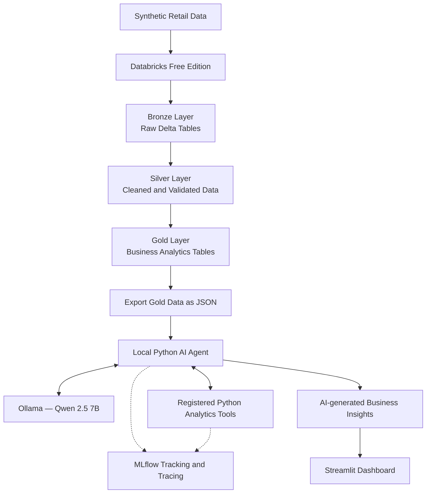

# RetailSphere — Agentic AI-Powered Retail Analytics

**An end-to-end retail analytics portfolio project combining Databricks, PySpark, local LLMs, Python analytics tools, MLflow, and Streamlit.**

RetailSphere transforms synthetic retail transaction data into business insights using a Medallion data architecture and a locally running AI analytics assistant.

## Project Overview

The project has two main components:

1. **Data Engineering:** A Databricks pipeline that processes retail data through Bronze, Silver, and Gold layers using Apache Spark and Delta tables.
2. **Agentic AI Analytics:** A local AI agent powered by Qwen 2.5 7B that uses Python analytics tools to answer natural-language business questions.

A Streamlit dashboard brings business analytics and the AI assistant together in one interface.

## Architecture



**Data connectivity note:** Databricks and the local AI application are separate execution environments. The Gold tables are exported to a JSON snapshot and copied to the local project. The local agent reads this snapshot; it does not query Databricks live. Re-export the data to refresh the snapshot.

## Technology Stack

| Area | Technology |
|---|---|
| Data engineering | Databricks Free Edition |
| Data processing | Apache Spark / PySpark |
| Data storage | Delta tables |
| Data architecture | Medallion architecture |
| Programming | Python |
| Local language model | Qwen 2.5 7B |
| LLM runtime | Ollama |
| Agent observability | MLflow |
| Dashboard | Streamlit |
| Data exchange | JSON |
| Version control | Git and GitHub |

## Repository Structure

```text
RetailSphere-Agentic-Retail-Analytics/
│
├── databricks/
│   ├── 00_environment_setup.py
│   ├── 01_retail_data_ingestion.py
│   ├── 02_silver_data_transformation.py
│   ├── 03_gold_business_analytics.py
│   ├── 04_retail_analytics_tools.py
│   └── 05_retail_ai_agent.py
│
├── agent/
│   ├── retail_agent.py
│   └── evaluate_agent.py
│
├── dashboard/
│   ├── app.py
│   └── pages/
│       ├── overview.py
│       ├── products.py
│       ├── regional.py
│       └── ai_assistant.py
│
├── data/
│   └── retailsphere_data.json
│
├── docs/
│   └── architecture.md
│
├── mlflow_evaluation.py
├── requirements.txt
├── .gitignore
└── README.md
```

## Databricks Data Engineering Pipeline

The pipeline uses a Bronze → Silver → Gold architecture.

### Bronze — Data Ingestion

Notebook: `01_retail_data_ingestion.py`

- Creates synthetic retail customers, products, orders, and order-item datasets.
- Ingests source datasets into Delta tables.
- Establishes the raw data foundation.

### Silver — Data Transformation

Notebook: `02_silver_data_transformation.py`

- Handles duplicate records.
- Cleans and standardises customer information.
- Converts and validates data types.
- Applies data-quality filters to orders, products, and order items.

### Gold — Business Analytics

Notebook: `03_gold_business_analytics.py`

- Joins customer, product, order, and order-item datasets.
- Calculates item-level revenue.
- Excludes cancelled orders from delivered-sales analysis.
- Produces business-ready analytical tables.

Gold tables:

- `gold_sales`
- `gold_monthly_revenue`
- `gold_product_performance`
- `gold_state_sales`

### Additional Databricks Notebooks

| Notebook | Purpose |
|---|---|
| `00_environment_setup.py` | Initial environment and project setup |
| `04_retail_analytics_tools.py` | Python analytics functions using Spark data |
| `05_retail_ai_agent.py` | Initial Databricks agent prototype |

The local Qwen-powered agent is maintained separately in the `agent/` directory.

## Local Agentic AI Assistant

The local AI assistant uses:

- Qwen 2.5 7B as the language model.
- Ollama for local model execution.
- Python functions as registered analytics tools.
- Tool schemas to describe available operations.
- Tool validation to restrict execution to registered functions.

### Supported Analytics Tools

- `get_total_revenue`
- `get_top_products`
- `get_state_revenue`
- `get_monthly_revenue`
- `get_top_products_revenue_contribution`

### Example Questions

- What is the total revenue generated by the business?
- Show the top three products by revenue.
- Which Indian state generated the highest revenue?
- Show monthly revenue.
- What percentage of revenue came from the top three products?

The agent uses tool results for business figures rather than relying on the language model to invent numerical answers.

## MLflow Observability and Evaluation

MLflow supports agent observability and experiment tracking.

Implemented capabilities:

- Agent execution tracing.
- Nested tool/function tracing.
- Experiment tracking.
- Evaluation metrics.
- Tool-selection validation.

The current evaluation suite reports **7/7 tests passed** on the synthetic project dataset.

This is a development test result, not a production reliability guarantee.

## Streamlit Dashboard

The dashboard includes:

- Business overview and revenue KPIs.
- Monthly revenue analysis.
- Product performance analytics.
- Regional sales analytics.
- Natural-language AI retail assistant.

## Sample Project Results

The current synthetic dataset produces:

| Metric | Result |
|---|---:|
| Total revenue | ₹184,000 |
| Gold sales records | 9 |
| Products | 5 |
| Monthly reporting periods | 3 |
| States represented | 5 |

### Top Products by Revenue

| Product | Revenue |
|---|---:|
| Laptop | ₹110,000 |
| Mobile | ₹50,000 |
| Headphones | ₹10,000 |
| Office Chair | ₹8,000 |
| Keyboard | ₹6,000 |

These results are generated from synthetic data for demonstration purposes.

## Limitations

- The retail dataset is synthetic.
- The local agent uses a static exported Gold JSON snapshot.
- The data snapshot must be refreshed manually after changes to the Databricks Gold tables.
- The local LLM requires Ollama and sufficient local computing resources.
- Revenue is not profit. Product costs and operating expenses are not included.
- This is a portfolio demonstration, not a production retail deployment.

## Future Enhancements

- Live connectivity between Databricks and the local agent.
- Inventory and profitability analytics.
- Expanded agent evaluation and reliability testing.
- Stronger tool governance and SQL safety.
- Production deployment and monitoring.

## Author

**Dony Varghese**

GitHub: [@donyvarghese](https://github.com/donyvarghese)

## License

License information will be added when a project license is selected.