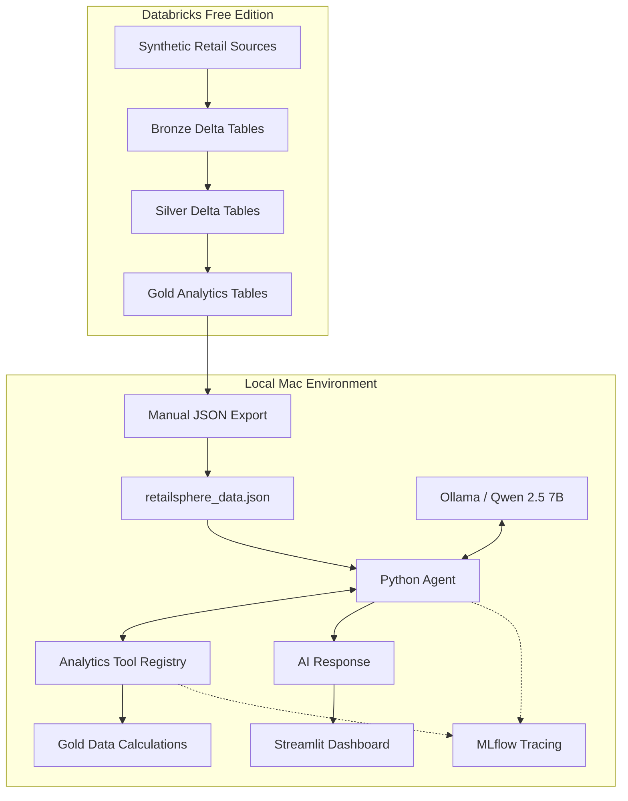

# RetailSphere — System Architecture

## 1. Architecture Overview

RetailSphere consists of two connected but separately executed environments:

- Databricks Free Edition: data ingestion, transformation, and business analytics.
- Local development environment: LLM-powered analytics agent, Python tools, MLflow, and Streamlit.

The connection between these environments is a manually exported Gold-layer JSON snapshot.

## 2. Architecture Diagram

## 3. Data Engineering Layer

### Bronze
Raw synthetic datasets are ingested into Delta tables:

- Customers
- Products
- Orders
- Order items

### Silver
Data-quality transformations include:

- Duplicate handling
- Null validation
- Type conversion
- Data cleaning
- Positive quantity and price validation

### Gold
Business analytics are created through joins and aggregations:

- Sales-level revenue
- Monthly revenue
- Product performance
- State-level revenue

## 4. Agent Layer

The local Python agent sends user questions to Qwen 2.5 7B through Ollama.

The model can select from registered analytics tools. The Python application validates tool names and arguments before execution.

Available tools:

- Total revenue
- Top products
- State revenue
- Monthly revenue
- Top-product revenue contribution

The model interprets questions and communicates results; Python performs the underlying calculations.

## 5. Observability

MLflow tracks agent execution and nested analytics-tool calls.

The project also includes an evaluation suite covering deterministic calculations, tool validation, and model tool selection.

## 6. Data Connectivity and Refresh

The agent does not connect directly to Databricks.

The current workflow is:

1. Run the Databricks pipeline.
2. Generate the Gold analytics tables.
3. Export the Gold results to JSON.
4. Copy the JSON file into the local project's `data/` directory.
5. Run the local agent and dashboard.

If Gold data changes, repeat the export and copy steps to refresh the local snapshot.

## 7. Deployment Scope

This is a local portfolio implementation.

- Databricks Free Edition is used for data engineering.
- Ollama runs the LLM locally.
- Python hosts the agent and analytics tools.
- MLflow uses local tracking storage.
- Streamlit runs the dashboard locally.

No Azure Cloud deployment or live cloud-to-local agent connection is currently implemented.